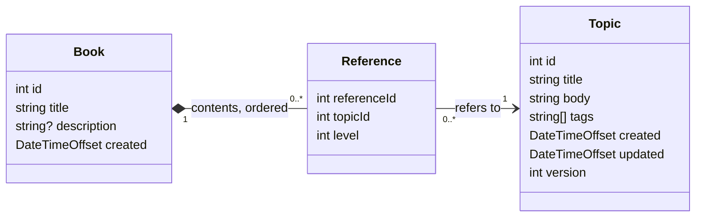

# Steele-IT: Author-it practical test

A small full-stack app that models Author-it's reuse-based content. Topics hold content. Books hold an ordered, indented list of **references** to topics, never copies. One topic can appear in many books, or several times in one book, and the app makes that reuse visible.

- **API:** .NET 10, ASP.NET Core controllers, in-memory storage
- **Web:** React + TypeScript, Vite, TanStack Query, React Router, Tailwind CSS

This README is the overview. The full API contract, rules and front-end behaviour are in [docs/spec.md](docs/spec.md).

## Running the project

**Prerequisites:** .NET 10 SDK, Node.js 22 or later.

```bash
npm install     # installs root tools and the web app's packages
npm run dev     # starts the API and the web app together
```

Then open http://localhost:5173. To run the apps separately: `dotnet run --project api/src/SteeleIT.Api` and `npm --prefix web run dev`.

| What | Where |
| --- | --- |
| Web app | http://localhost:5173 |
| API | http://localhost:5080 (http only) |
| Swagger UI / Scalar | http://localhost:5080/swagger, http://localhost:5080/scalar (Development only) |
| Example requests | [`api/requests.http`](api/requests.http) (VS Code REST Client, Visual Studio or Rider) |

**CORS:** one policy, `web-dev`, allows `http://localhost:5173` with any method and header, and exposes the `ETag` header. The web app reads the API address from `VITE_API_BASE_URL` (default `http://localhost:5080`).

**Other commands:** `npm test` runs all tests. `npm run format` fixes formatting, and `npm run lint` checks it ([code style](docs/spec.md#code-style)).

Data is in memory and re-seeded with the brief's 5 topics and 3 books on every start.

## Repo layout

```
api/src/SteeleIT.Api
  Domain/        rules as pure functions: OutlineRules, TopicRules, BookRules
  Library/       LibraryService (all state + one lock), seed data
  Contracts/     request and response DTOs
  Controllers/   TopicsController, BooksController
api/tests        domain unit tests + 5 API integration tests
web/src
  api/           fetch client, types, query keys, query hooks
  components/    small shared UI pieces
  features/      topics/ (library, editor) and books/ (list, outline)
docs/spec.md     detailed design
```

The project is called **Steele-IT**. In .NET code it is `SteeleIT` (`SteeleIT.slnx`, `SteeleIT.Api`, namespace `SteeleIT.Api`), because C# names cannot contain hyphens. npm package names must be lowercase, so the root package is `steele-it`.

## How it is designed



- **Reuse is the model.** A reference stores only `topicId` and `level`. Its `position` (list index + 1) and `topicTitle` are worked out when read, so inserts never renumber anything and a renamed topic shows its new title in every book.
- **Rules live in one place.** Outline, topic and book rules are pure functions in `Domain/`, unit tested. Every change to a book validates the whole resulting outline, so there are no special cases.
- **State is safe under concurrent requests.** `LibraryService` owns all data and one lock. Each operation (validate, check version, write) runs inside it.
- **The front end never holds stale server data.** Server state lives only in TanStack Query and is invalidated after every change. The topic editor's form is deliberately separate from the cache, so a background refetch can never overwrite what the author is typing.

## Decisions and trade-offs

| Decision | Why | Trade-off |
| --- | --- | --- |
| Keep the brief's flat, levelled outline | Simple inserts and removes; one validator covers every change. | The hierarchy is derived on read. |
| `If-Match` + `ETag` for topic updates | HTTP's own precondition mechanism; a stale update changes nothing. | The client must send a header, not just a body field. |
| Duplicate tags are rejected, not removed | Silent changes surprise authors; the error points at the exact tag. | One more error state in the UI. |
| An entry and its children are one unit | See [Removing an entry with children](#removing-an-entry-with-children). | Removal is two steps when children exist. |
| Books have no version | Each change is atomic, so nothing is lost. | Concurrent outline edits can land next to an unexpected neighbour (positions go stale). |
| React + TypeScript, TanStack Query | The brief's preferred stack. Query invalidation is what keeps every screen in sync after edits. | — |
| React Router (data router) | Every screen has a URL (two tabs demonstrate conflicts), and `useBlocker` guards unsaved changes. | — |
| Tailwind CSS | Familiar and quick; class strings stay inside a few small components. | Long class lists, kept out of page code. |
| No form or validation libraries | Two small forms; the server owns validation. | — |
| Length limits are constants, not configuration | The brief fixes them. One C# class feeds the rules and tests; the web app mirrors them for input hints. | Changing a limit means editing two files. Making them configurable would need an `IOptions` setting and a small endpoint for the web app. |
| Style enforced by tooling, no pre-commit hooks | The build and `npm run lint` keep human and AI-written code consistent. Every commit is made by hand after review. | — |

### Status codes

**The rule:** 404 means the URL is wrong. 400 means the body is wrong, with errors keyed by field. 409 means the action would affect something the author should see first. 412 and 428 are concurrency preconditions. All errors use Problem Details (`application/problem+json`).

| Situation | Chosen | Alternative | Why |
| --- | --- | --- | --- |
| Update based on a stale version | 412 | 409 | The version travels in `If-Match`; 412 is its defined failure. 409 stays for state conflicts. |
| `PUT` without `If-Match` | 428 | 400 | RFC 6585 defines 428 for exactly this. |
| Validation failure | 400 | 422 | ASP.NET's default; malformed JSON is already 400. One status for "the body is wrong". |
| Adding a reference to a topic that does not exist | 400, on `topicId` | 404, 422 | 404 would suggest the book in the URL is missing. A body field is wrong, and the UI shows it next to that field. |
| Position out of range | 400 | Clamp | Clamping hides client bugs. |
| Removing an entry that has children | 409 until `?cascade=true` | Silent cascade | The request is valid but would remove entries the author has not seen. |
| Deleting a topic books still use | 409 | Cascade, soft delete | See [Deleting a topic](#deleting-a-topic). |

## Removing an entry with children

**An entry and the entries indented beneath it are treated as one unit. Removing it removes them too, after the author confirms.**

The API returns 409 with the list of child entries until the request adds `?cascade=true`. The UI shows that list in a confirmation dialog, then repeats the request with the flag. Removing a whole subtree always leaves a valid outline, so no other entry's level changes, and topics are never deleted.

I chose this over outdenting the children, which quietly restructures a book the author did not ask to change, and over always rejecting, which forces the author to remove each child first.

## Deleting a topic

**A topic that any book still references cannot be deleted.** The API returns 409 listing the books that use it. The author removes those references first, then deletes the topic. In a reuse model, deleting shared content is the most damaging mistake an author can make, so it should be deliberate. In production I would use a soft delete instead, for undo and audit.

## Status

*Completed at the end: what is built and the total time spent.*

## With more time

*Completed at the end: every planned item that was not finished, with a line on how I would approach it.*

## How I used AI

- I read the brief and drafted my decisions, then used Claude to look for weak spots. The decisions here are mine.
- The design was written down first ([docs/spec.md](docs/spec.md)). Each component was then built by Claude Code from a written prompt, under the ground rules in [CLAUDE.md](CLAUDE.md).
- Agents could stage changes but never commit. I reviewed every diff, ran each component by hand, wrote the domain test cases myself, and made every commit.
- A fresh agent reviewed the finished repo against the brief, read-only, before submission.
