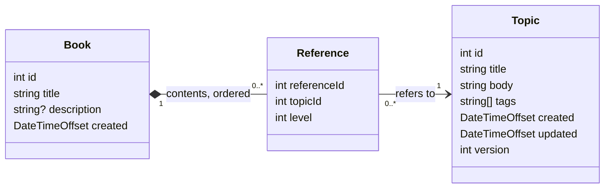

# Steele-IT: Author-it practical test

A small full-stack app that models Author-it's reuse-based content. Topics hold the content. Books hold an ordered, indented list of **references** to topics, never copies, so one topic can appear in many books, or several times in one book, and editing it once updates them all.

**Tech stack:**

- **API:** .NET 10, ASP.NET Core controllers, in-memory storage (`api/`)
- **Web:** React + TypeScript, Vite, TanStack Query, React Router, Tailwind CSS (`web/`)

**Overview of data models:**



A reference stores only its topic and level. Its position and the topic's title are worked out when read, so inserting never renumbers anything and a renamed topic shows its new title in every book.

The full API contract, rules and front-end behaviour are in [docs/spec.md](docs/spec.md)

The development plan used to create this project are in [docs/dev-plan.md](docs/dev-plan.md)

## How to run the project:

You need the .NET 10 SDK and Node.js 22 or later. From the repo root:

```bash
npm install     # installs everything, including the .NET formatting tool
npm run dev     # starts the API and the web app together
```

Then open **http://localhost:5173**.

| What                  | Where                                                                          |
| --------------------- | ------------------------------------------------------------------------------ |
| Web app               | http://localhost:5173                                                          |
| API                   | http://localhost:5080 (http only)                                              |
| Swagger UI / Scalar   | http://localhost:5080/swagger, http://localhost:5080/scalar (Development only) |
| Example http requests | [`api/requests.http`](api/requests.http)                                       |

- **CORS:** the API allows `http://localhost:5173` (any method and header) and exposes the `ETag` header. Use `localhost` rather than `127.0.0.1`, which is a different origin.
- **Run each app on its own:** `dotnet run --project api/src/SteeleIT.Api` and `npm --prefix web run dev`.
- **Tests and checks:** `npm test` runs all tests; `npm run lint` checks formatting and style.
- **Data:** held in memory and re-seeded with the brief's 5 topics and 3 books on every start.

## Design decisions and trade-offs, including the status codes:

- **Rules live in one place.** Outline, topic and book rules are pure, unit-tested functions in `Domain/`. Every change to a book validates the whole resulting outline, so there are no special cases.
- **Updates can't overwrite someone else's work.** A topic save sends the version it was loaded at in an `If-Match` header. If the topic has changed since, the save is rejected and nothing changes. The editor keeps the author's edits and offers to reload the latest version.
- **The editor's form is separate from the cached data,** so a background refresh never overwrites what the author is typing. Every other screen refreshes from the server after each change, so a renamed topic shows up in every book straight away.
- **Duplicate (topic) tags are rejected, not silently removed,** and the error points at the exact tag.
- **Stack:** React + TypeScript as the brief prefers, TanStack Query for server data, React Router so every screen has its own URL, and Tailwind for quick styling. No form or validation libraries: the server owns validation.

### Status codes

**The rule:** 404 means the URL is wrong. 400 means the request body is wrong, with errors keyed by field. 409 means the action would affect something the author should see first. 412 and 428 are about edit conflicts. Every error uses the same Problem Details format.

| Situation | Chosen | Why I chose this one |
| --- | --- | --- |
| **Stale topic:** you save a topic that another user has updated since you started editing it | [412 Precondition Failed](https://developer.mozilla.org/en-US/docs/Web/HTTP/Reference/Status/412) | MDN: *"If the hashes don't match, the document has been edited in-between and a 412 Precondition Failed error is thrown."* The save sends the version you loaded in `If-Match`, so a stale save is rejected and nothing is overwritten. |
| **Missing version:** a save arrives without saying which version it was based on (a client bug; the app always sends it) | [428 Precondition Required](https://developer.mozilla.org/en-US/docs/Web/HTTP/Reference/Status/428) | MDN: *"Typically, a 428 response means that a required precondition header such as If-Match is missing."* |
| **Invalid topic or book:** a missing title, a title or tag that is too long, or a duplicate tag | [400 Bad Request](https://developer.mozilla.org/en-US/docs/Web/HTTP/Reference/Status/400) | MDN: *"…the server would not process the request due to something the server considered to be a client error."* Each error names its field, so the app shows it next to that field. |
| **Unknown topic:** you add a topic to a book, but that topic no longer exists (for example, it was just deleted) | [400 Bad Request](https://developer.mozilla.org/en-US/docs/Web/HTTP/Reference/Status/400) on `topicId` | The book in the URL exists, so 404 would be misleading. The problem is a field in the request, and the app shows it next to the topic picker. |
| **Unsupported position:** you try to add a topic to a book at a position or level the outline doesn't allow (for example, level 3 straight after a level-1 chapter) | [400 Bad Request](https://developer.mozilla.org/en-US/docs/Web/HTTP/Reference/Status/400) | MDN: *"…something the server considered to be a client error."* The request is rejected rather than quietly adjusted, so the author's intent is never changed behind their back. |
| **Topic added:** you add a topic to a book successfully | [201 Created](https://developer.mozilla.org/en-US/docs/Web/HTTP/Reference/Status/201) | MDN: *"…the HTTP request has led to the creation of a resource."* A reference has no URL of its own, so the `Location` header points at the book that now contains it, and the whole book is returned because later entries' positions change. |
| **Entry with children:** you remove an entry from a book that has other entries indented beneath it | [409 Conflict](https://developer.mozilla.org/en-US/docs/Web/HTTP/Reference/Status/409) | MDN: *"…a request conflict with the current state of the target resource."* The app lists the entries that would also go and asks you to confirm, then repeats the request with `?cascade=true`. |
| **Topic still in use:** you try to delete a topic that one or more books still use | [409 Conflict](https://developer.mozilla.org/en-US/docs/Web/HTTP/Reference/Status/409) | MDN: *"…a request conflict with the current state of the target resource."* The response lists the books that use the topic, so you can remove it from them first. See below. |

## What happens to indented entries when a reference above them is removed:

**They are removed too, after the author confirms.** An entry and the entries indented beneath it are treated as one unit.

When the author removes an entry that has children, the app lists them and asks first: "Removing _Installing the Desktop Client_ also removes the 1 entry indented beneath it: _Connecting to a Library_."

Behind the scenes the API returns 409 with that list, and only removes the whole group when the request adds `?cascade=true`. Topics themselves are never deleted, and the rest of the outline is left exactly as it was.

## How I handled deleting a topic that book(s) still reference:

**It can't be deleted while any book uses it.** The API returns 409 with the list of books that use it, and the editor shows those books with links, so the author can remove the references first and then delete the topic. A topic no book uses is deleted after a confirmation.

Deleting shared content is the most damaging mistake an author can make in a reuse model, so it should always be deliberate and never silently change other books. In production I'd use a soft delete instead, so a deletion could be undone and audited.

## What is built, unfinished, and what I would do differently with more time:

**Built:** Everything in the brief's Parts A and B, plus four stretch goals: a single-command start, a warning before leaving unsaved changes, deleting a topic, and front-end tests.

**Unfinished:** Nothing in the repo is in an unfinished state. 

**With more time:** (in this order)

1. **Version books,** using the same `If-Match` approach as topics, so concurrent outline edits are caught too.
2. **Move a reference.** `PATCH /books/{id}/references/{referenceId}` taking a new position and/or level. An entry would move together with the entries indented beneath it, the same unit as removal, and the result would go through the same outline validator. In the outline: Indent and Outdent buttons, plus a Move form reusing the Add reference inputs.
3. **Soft delete on topics** So a user can undo a deletion and also for auditing purposes.
4. **User audit log page** Include a new page in the UI that lists every edit / create / delete action a user has comleted for auditing purposes. This page could include the topic delete "undo button" that is mentioned above.
5. **Run with Aspire / Docker.** An AppHost that starts the API and the web app together, with the Aspire dashboard for logs and traces. Web and UI run in docker containers for reliability.
